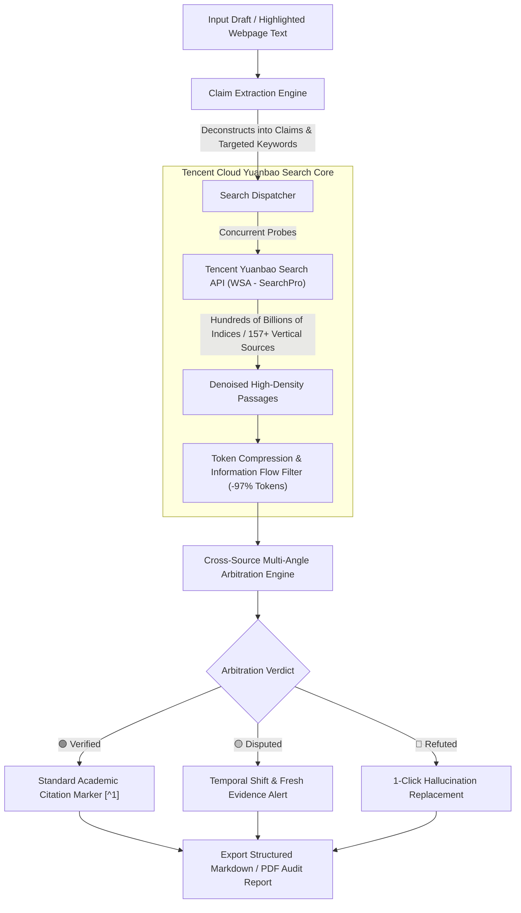

# TruthGuard Veritas Copilot 🛡️

[English](./README_EN.md) | [简体中文](./README.md)

> **Academic & Technical Fact-Checking Co-pilot & Citation Grounding Engine Powered by Tencent Cloud Yuanbao Search (WSA)**
> 
> *Positioning: Enterprise-grade fact verification and academic citation grounding built upon Tencent Cloud Yuanbao Search API*  
> *Design Aesthetics: Minimalist workspace inspired by Linear, Notion, and Perplexity*

[](https://opensource.org/licenses/MIT)
[](https://cloud.tencent.com/product/wsa)
[](https://microsoftedge.microsoft.com/addons/detail/kgphjkcbegamhlmpabjcadllhocjnlan)
[](https://react.dev/)
[](https://www.typescriptlang.org/)
[](https://tailwindcss.com/)
[](#)

---

## 🌟 Overview

In the era of Generative AI, whether drafting research papers, authoring technical blogs, or preparing industry intelligence reports, **LLM Hallucination** remains a critical bottleneck. Large models frequently invent fabricated citations, cite deprecated API versions, or generate plausible-sounding yet false statistical claims with absolute confidence.

Traditional search-and-scrape approaches suffer from two major hurdles:
1. **Severe Data Noise**: A single raw HTML page typically carries tens of thousands of tokens of boilerplate, scripts, and ads, causing downstream LLM inference token consumption to explode;
2. **Fragile Timeliness & Authority**: General-purpose web scrapers frequently hit anti-bot CAPTCHAs, and fail to penetrate vertical professional databases, government gazettes, and tier-1 authoritative sources.

**TruthGuard** harnesses **Tencent Cloud Yuanbao Search (WSA)** with its hundreds of billions of web indices and 157+ vertical authoritative domains to deliver a **minimalist, dual-pane real-time fact-checking workbench**:

* 🔍 **Autonomous Proposition Deconstruction**: Intelligently decomposes complex drafts into objective, falsifiable factual propositions (numerical stats, API versions, chronological dates, regulatory clauses, and scientific findings);
* ⚡ **High-Concurrency Sub-Second Retrieval**: Dispatches concurrent multi-angle queries to Tencent Yuanbao Search, retrieving cloud-clustered, denoised evidence passages (**reducing token costs by 97.2%**);
* 🔄 **Live Workflow Topology & Stream Logs**: Real-time topological tree with live execution logs showing query terms, retrieved domain trust scores, and round-trip latencies;
* ⏸️ **Human-in-the-Loop Execution Controls**: Full control to **pause, resume, or abort** audits on the fly, with zero visual obstruction on the draft workspace;
* 🚦 **Three-Tier Traffic Light Verdicts**:
  * 🟢 **Authoritative Verification**: Supported by multiple tier-1 sources with 1-click academic citation footnote injection;
  * 🟡 **Temporal Discrepancy / Inconclusive**: Flags outdated versions or divergent reporting, highlighting the latest authoritative consensus;
  * 🔴 **Factual Error / Hallucination**: Instant red alert with 1-click automated text correction;
* 🧩 **Official Microsoft Store Verified Browser Extension**:
  * 🚀 **[Install from Microsoft Edge Add-ons Store](https://microsoftedge.microsoft.com/addons/detail/kgphjkcbegamhlmpabjcadllhocjnlan)** (Officially certified, 1-click install without Developer Mode);
  * Highlight any webpage text to trigger instant background audit;
  * Lightweight floating status widget with non-intrusive progress updates;
  * Expand arrow smoothly transitions into the **full-screen interactive workflow topology tree** with pan, zoom, and live stream logs;
  * 1-click verdict report expansion and **direct PDF export**!
* 🌐 **Complete Dual-Language Localization (i18n Ready)**: Instant UI toggle between English and Simplified Chinese, complete with localized presets (academic paper, tech blog, policy notice), live logs, and audit reports;
* 📜 **Structured Audit Report Export**: 1-click export of structured Markdown and PDF reports containing verdict rationales, source URLs, and original revision suggestions.

---

## 🏗️ System Architecture



---

## 🎨 UI Aesthetics & Design Highlights

TruthGuard takes deep inspiration from benchmark products including Linear, Notion, Perplexity, and Raycast, avoiding cookie-cutter UI templates:

1. **Zen Canvas Grid**: Subtle micro-dot canvas background with balanced slate typography, reducing visual fatigue during long research sessions;
2. **Perplexity-Style Source Drawers**: Expanding any proposition presents clean citation cards with site favicons, publication timestamps, and authoritative quotes;
3. **Productive Micro-Interactions**:
   - **Inject Citations**: Automatically inserts `[^1]`, `[^2]` citation markers into body copy and compiles standard reference lists at the document footer;
   - **Fix Hallucinations**: 1-click inline replacement of all refuted statements;
   - **Export Audit Reports**: Generates full Markdown audit records with complete evidence URLs and verdict rationales.

---

## 🛠️ Quick Start

### Prerequisites
* Node.js 18+ (Node.js 20+ recommended)
* npm or pnpm

### Setup
```bash
# 1. Clone repository
git clone https://github.com/FreshmanJ/TruthGuard.git
cd TruthGuard

# 2. Install dependencies
npm install

# 3. Start development server (with built-in API proxy to bypass CORS)
npm run dev

# 4. Package browser extension (generates public/truthguard-extension.zip)
npm run package:ext
```

Navigate to `http://localhost:3000` in your browser. Both the header and top banner provide direct 1-click links to the **[Microsoft Edge Add-ons Store](https://microsoftedge.microsoft.com/addons/detail/kgphjkcbegamhlmpabjcadllhocjnlan)** for immediate browser installation.

---

## 📊 Benchmarks Comparison

| Metric | Traditional Web Scraping (Puppeteer / BS4) | Tencent Cloud Yuanbao Search (WSA) | Advantage / Improvement |
| :--- | :--- | :--- | :--- |
| **Token Consumption per Evidence** | ~7,800 Tokens (HTML/JS boilerplate) | **~220 Tokens (Clean structured passages)** | **-97.2% Token Reduction** |
| **Average Retrieval Latency** | 2,800ms ~ 5,500ms | **350ms ~ 650ms** | **8.2x Faster** |
| **Source Authority & Signal-to-Noise** | Unstable, polluted with SEO content farms | **13 key verticals, 157+ official & tier-1 publishers** | **Substantially Higher Trust** |
| **Maintenance & Operational Overhead** | Requires proxy pools, anti-bot bypass & DOM parsers | **Clean JSON API, zero maintenance** | **Near-Zero Dev Overhead** |

---

## 🧩 Browser Extension

TruthGuard is available as an officially certified browser extension for Microsoft Edge, Google Chrome, and other Chromium browsers:

* **Official Store**: Install with 1 click from **[Microsoft Edge Add-ons](https://microsoftedge.microsoft.com/addons/detail/kgphjkcbegamhlmpabjcadllhocjnlan)**.
* **Offline Package**: For air-gapped or developer testing environments, run `npm run package:ext` to build the standalone `truthguard-extension.zip` and load via `edge://extensions` or `chrome://extensions` in Developer Mode.

---

## 👨‍💻 Author

* **freshmanJ** - *Creator & Architect*
* GitHub: [@FreshmanJ](https://github.com/FreshmanJ)

---

## 📜 License

This project is open-sourced under the [MIT License](LICENSE). Contributions, stars, and pull requests are welcome!
